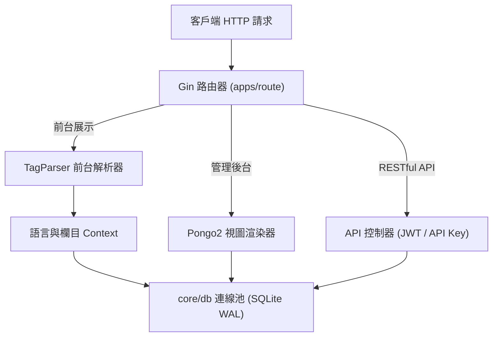

# 📦 系統架構 (Architecture)

Gbootcms 採用單一二進制與扁平模組化設計，各層次職責邊界清晰，避免過度封裝。

---

## 🏛️ 架構全景



---

## 🗄️ 資料庫連線池設計 (`core/db/db.go`)

系統維持全域單一資料庫連線實例，避免重複開啟連線耗用檔案控制代碼。

### SQLite PRAGMA 核心參數

| 參數 | 設定值 | 功能說明 |
| :--- | :--- | :--- |
| `journal_mode` | `WAL` | 寫入預寫日誌模式，允許多 reader 與單 writer 併發執行 |
| `synchronous` | `NORMAL` | 同步寫入策略，平衡 I/O 效率與資料安全 |
| `busy_timeout` | `5000` | 鎖競爭逾時重試上限（毫秒） |
| `cache_size` | `-64000` | 頁面快取上限（約 64MB 記憶體） |

### 連線池設定代碼

```go
func InitDB(cfg *config.Config) error {
    db, err := gorm.Open(sqlite.Open(dsn), &gorm.Config{
        Logger: logger.Default.LogMode(logMode),
    })
    if err != nil {
        return err
    }
    
    sqlDB, err := db.DB()
    if err != nil {
        return err
    }

    sqlDB.SetMaxOpenConns(20)
    sqlDB.SetMaxIdleConns(5)
    sqlDB.SetConnMaxLifetime(time.Hour)

    db.Exec("PRAGMA journal_mode = WAL;")
    db.Exec("PRAGMA synchronous = NORMAL;")
    db.Exec("PRAGMA busy_timeout = 5000;")
    db.Exec("PRAGMA cache_size = -64000;")

    DB = db
    return nil
}
```

---

## 🔄 結構遷移機制 (`apps/admin/model/migrate.go`)

系統將各業務模組的資料表自動遷移收斂為單一全域呼叫入口：

```go
func MigrateAll() error {
    if err := system.AutoMigrate(DB); err != nil {
        return err
    }
    if err := content.AutoMigrate(DB); err != nil {
        return err
    }
    if err := member.AutoMigrate(DB); err != nil {
        return err
    }
    return nil
}
```

---

## 📊 運行時系統遙測 (`core/version/telemetry.go`)

後台首頁與伺服器資訊頁統一由標準遙測函式提供指標數據：

```go
telemetry := version.GetTelemetry()
// 返回欄位：
// - telemetry.Uptime: 進程運行持續時間
// - telemetry.AllocMB: 已分配堆記憶體 (MB)
// - telemetry.TotalAllocMB: 累計分配記憶體 (MB)
// - telemetry.SysMB: 系統保留記憶體 (MB)
// - telemetry.NumGC: GC 觸發次數
// - telemetry.Goroutines: 當前活躍 Goroutine 數量
```
