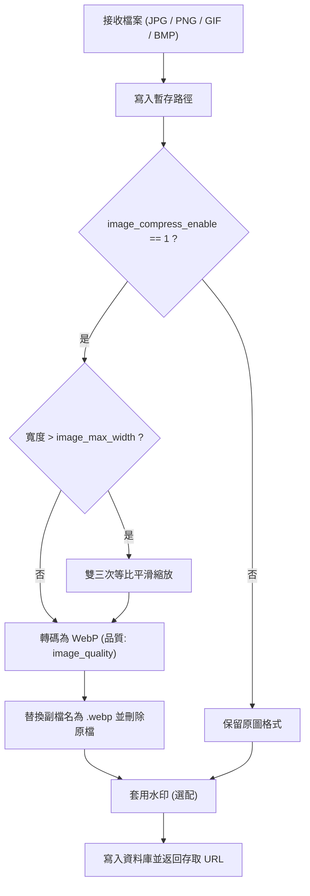

# 🖼️ 圖片轉碼管線 (Image Processing)

Gbootcms 提供伺服器端原生圖片處理管線（`apps/common/imgcompress`），於上傳時自動執行圖片尺寸約束與 WebP 格式轉換。

---

## ⚡ 功能特性

- **零 CGO 依賴**：基於純 Go VP8 編碼模組，相容靜態交叉編譯。
- **全入口涵蓋**：適用於單圖上傳、多圖相簿、富文字編輯器（UEditor）以及 RESTful API 上傳介面。
- **自適應縮放**：採用雙三次插值（Bicubic interpolation）演算法進行等比例下採樣，保留邊緣清晰度。
- **體積最佳化**：將傳統 JPEG / PNG 圖片轉碼為 WebP，降低網路傳輸頻寬與磁碟占用。

---

## 🔄 處理流程



---

## 🛠️ API 呼叫規格

### 呼叫函式

```go
newPath, err := imgcompress.CompressToWebP(rawFilePath, imgcompress.Options{
    Quality:  80,   // 壓縮品質參數 (1 - 100)
    MaxWidth: 1920, // 最大限制像素寬度
})
```

### Options 結構參數

| 欄位 | 類型 | 預設值 | 說明 |
| :--- | :--- | :--- | :--- |
| `Quality` | `int` | `80` | WebP 有損壓縮品質因子（數值範圍 1 至 100） |
| `MaxWidth` | `int` | `1920` | 最大寬度限制（像素）。若原始寬度超出此值，自動等比縮放 |

---

## ⚙️ 系統配置參數

可於後台「全局配置」->「配置參數」中即時調整，變更即刻生效：

| 設定鍵 | 類型 | 預設值 | 說明 |
| :--- | :--- | :--- | :--- |
| `image_compress_enable` | 字串 (`0`/`1`) | `1` | 圖片轉碼總開關（`1` 開啟，`0` 停用） |
| `image_quality` | 字串 (整數) | `80` | WebP 編碼品質 |
| `image_max_width` | 字串 (整數) | `1920` | 圖片最大寬度限制 |
| `image_warn_size` | 字串 (整數) | `1024` | 單圖預警閥值（KB） |
